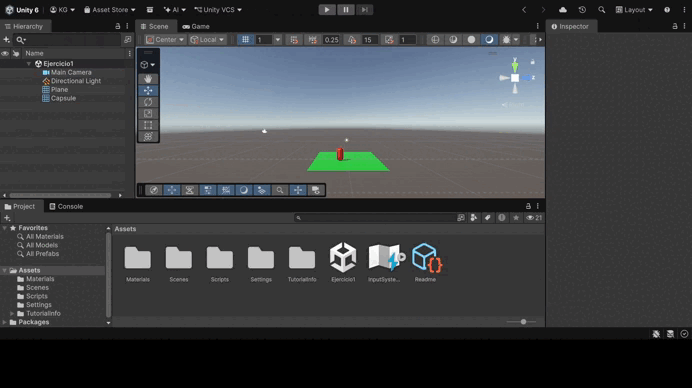
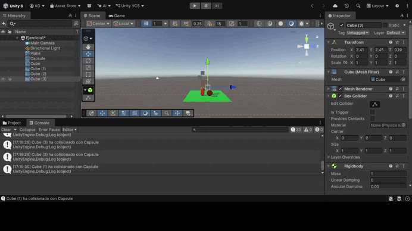
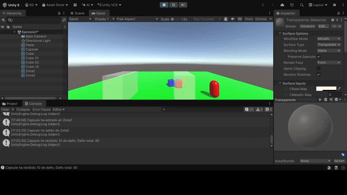
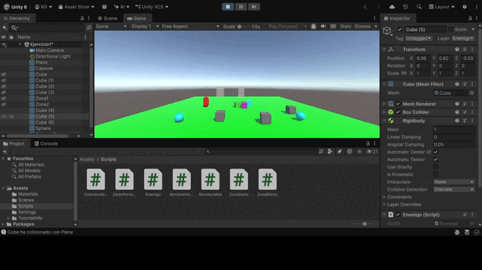
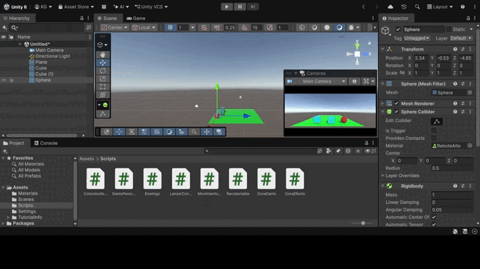
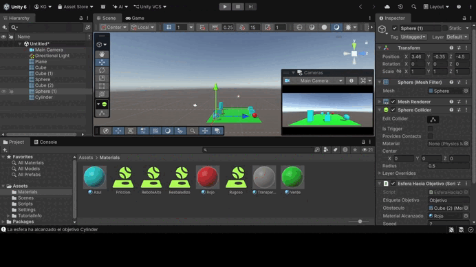

# Práctica de Unity: Físicas — Ejercicios

En estos ejercicios se trabaja con el motor de física de Unity: movimiento mediante Rigidbody, detección de colisiones y triggers, capas y la Layer Collision Matrix, Physic Materials y fuerzas con `AddForce`. En los objetos con Rigidbody el movimiento lo realiza el motor de física, nunca el Transform. Cada ejercicio incluye un GIF con la prueba de ejecución y el enlace a sus scripts.

⬅️ Volver a las situaciones: [README.md](README.md)

---

## Ejercicio 1: Personaje controlado con Rigidbody

El personaje se mueve con WASD o las flechas a través de su Rigidbody. La entrada se lee en `Update` con `GetAxisRaw` y el movimiento se aplica en `FixedUpdate` asignando la velocidad del Rigidbody. Así responde de forma inmediata (control total, sin inercia) y sigue chocando con los demás objetos. Se conserva la componente Y de la velocidad para que actúe la gravedad y se congela la rotación en X y Z para que no vuelque.

📄 Script: [Movimientopersonaje.cs](Scripts/Movimientopersonaje.cs)

---

## Ejercicio 2: Cambio de color al colisionar

Varios cubos y esferas con Rigidbody dinámico detectan sus colisiones con `OnCollisionEnter`. Al colisionar, muestran en la consola el nombre del objeto con el que han chocado y cambian a un color aleatorio. Una opción en el Inspector permite cambiar el color del propio objeto o el del objeto con el que choca.

📄 Script: [Coloralcolisionar.cs](Scripts/Coloralcolisionar.cs)

---

## Ejercicio 3: Zonas trigger

Dos cubos grandes con *Is Trigger* actúan como zonas que solo reaccionan al objeto con la etiqueta *Player*. Al entrar en la primera, el personaje cambia de color y la luz de la escena se oscurece; al salir, se restauran los valores originales con `OnTriggerExit`. La segunda zona aumenta la variable `danio` del personaje cada vez que entra.

📄 Scripts: [ZonaEfecto.cs](Scripts/ZonaEfecto.cs) · [ZonaDanio.cs](Scripts/ZonaDanio.cs) · [DanioPersonaje.cs](Scripts/DanioPersonaje.cs)

---

## Ejercicio 4: Capas y Layer Collision Matrix

Se crean las capas *Jugador*, *Enemigos* y *Recolectables*. En la Layer Collision Matrix (**Project Settings → Physics**), los enemigos solo interactúan con el jugador, por lo que atraviesan al resto de objetos (y no usan gravedad para no atravesar el suelo). Los recolectables tienen el collider como trigger y también solo interactúan con el jugador, que los recoge al pasar por ellos.

📄 Scripts: [Enemigo.cs](Scripts/Enemigo.cs) · [Recolectable.cs](Scripts/Recolectable.cs)

---

## Ejercicio 5: Physic Materials y AddForce

Se crean tres Physic Materials: resbaladizo (fricción 0), rugoso (fricción 1) y rebote alto (*Bounciness* 0.95), con los modos *Combine* ajustados para que predominen sobre el material del plano. Al pulsar X, cada objeto recibe el mismo impulso con `AddForce` en modo `Impulse`. El cubo resbaladizo se desliza lejos, el rugoso se frena enseguida y la esfera de rebote alto bota varias veces.

📄 Script: [LanzarConFuerza.cs](Scripts/LanzarConFuerza.cs)

---

## Ejercicio 6: Esfera hacia el objetivo con obstáculo

Un cubo, una esfera y un cilindro alineados tienen Collider pero no Rigidbody. El cilindro se marca con la etiqueta *Objetivo* y la esfera se dirige hacia él. Como ningún objeto tiene Rigidbody, no se ejecutan los eventos de colisión, así que los contactos se detectan con `Physics.OverlapSphere`. Al alcanzar el cubo, este cambia de material, y la esfera se detiene al llegar al cilindro.

📄 Script: [EsferaHaciaObjetivo.cs](Scripts/EsferaHaciaObjetivo.cs)
