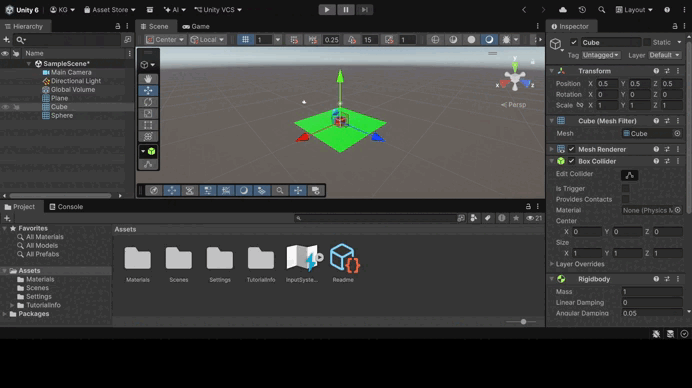
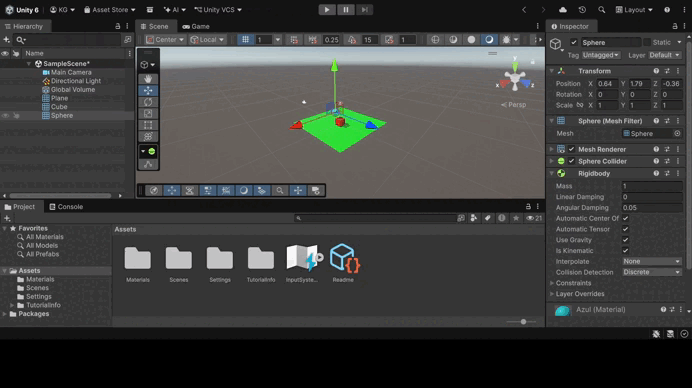
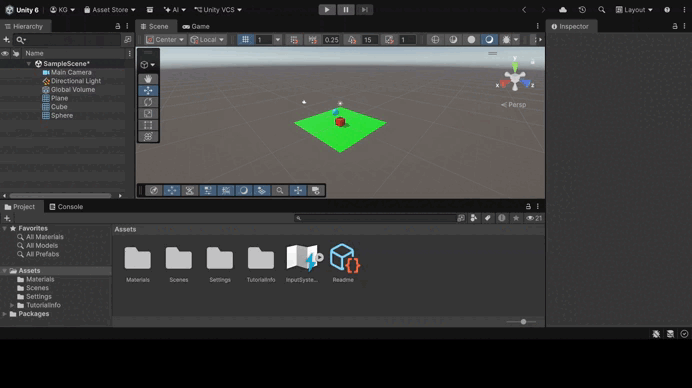
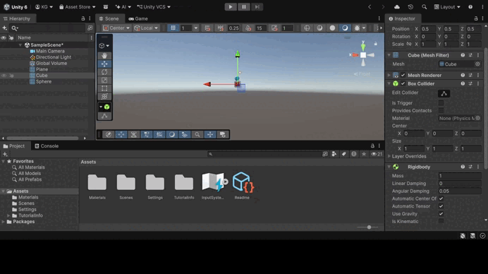
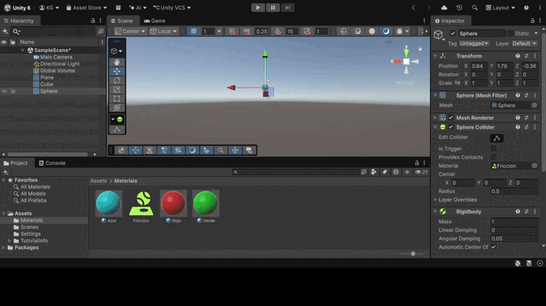
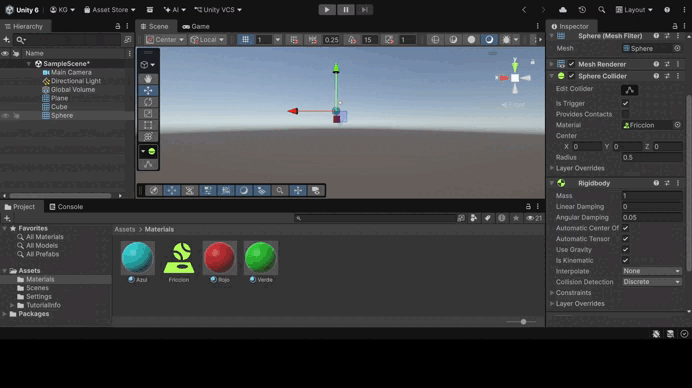

# Práctica de Unity: Físicas

En esta práctica se estudia el motor de física de Unity: la diferencia entre objetos estáticos (solo Collider), físicos (Rigidbody dinámico), cinemáticos (Rigidbody con *Is Kinematic*) y triggers. En las situaciones se combinan un plano, un cubo y una esfera con distintas configuraciones para observar cómo interactúan, cómo influyen la masa y la fricción y en qué se diferencia una colisión de un trigger. Cada situación incluye un GIF con la prueba de ejecución.

📘 Los ejercicios de la práctica, con sus scripts, están en el informe: [Ejercicios.md](Ejercicios.md)

---

## Situación 1: plano y esfera estáticos, cubo físico

**Configuración:** plano y esfera solo con Collider; cubo con Rigidbody.

El cubo cae por la gravedad y se queda sobre el plano. 

---

## Situación 2: cubo y esfera físicos

**Configuración:** plano solo con Collider; cubo y esfera con Rigidbody.

Los dos objetos caen y se quedan sobre el plano. Al chocar se empujan mutuamente: la esfera rueda y el cubo se desplaza.

---

## Situación 3: esfera cinemática

**Configuración:** plano solo con Collider; cubo con Rigidbody; esfera con Rigidbody *Is Kinematic*.

La esfera no cae ni reacciona. Un objeto cinemático afecta a los demás, pero los demás no le afectan a él.

---

## Situación 4: plano, cubo y esfera físicos

**Configuración:** los tres con Rigidbody dinámico (el Mesh Collider del plano con *Convex*).

El plano también se ve afectado por la gravedad, así que los tres objetos caen a la vez y nada los sostiene. Muestra por qué el suelo no debe ser un objeto físico.

---

## Situación 5: plano cinemático, esfera con 10 veces la masa del cubo

**Configuración:** plano con Rigidbody *Is Kinematic*; cubo con masa 1; esfera con masa 10.

El plano se queda fijo y sostiene a los demás. Al chocar, el cubo mueve la esfera, mientras que la esfera empuja al cubo desplazándolo levemente.

---

## Situación 6: plano cinemático, esfera con 100 veces la masa del cubo

**Configuración:** igual que la situación 5, con la esfera de masa 100.

La diferencia es aún mayor: para el cubo, la esfera es prácticamente inamovible, casi como un objeto estático. El cubo se desplaza mucho más.

---

## Situación 7: esfera con fricción

**Configuración:** los tres con Rigidbody; la esfera con un Physic Material de fricción alta.

La fricción hace que la esfera pierda velocidad antes cuando desliza o es empujada sobre una superficie.

---

## Situación 8: esfera no física y trigger

**Configuración:** plano cinemático; cubo con Rigidbody; esfera con Rigidbody *Is Kinematic* y Collider con *Is Trigger*.

La esfera se queda en su sitio y deja de ser sólida.

---

## Situación 9: esfera física y trigger

**Configuración:** plano cinemático; cubo con Rigidbody; esfera con Rigidbody dinámico y Collider con *Is Trigger*.

La esfera cae por la gravedad, pero, al ser trigger, no choca con el plano: lo atraviesa y sigue cayendo. 

